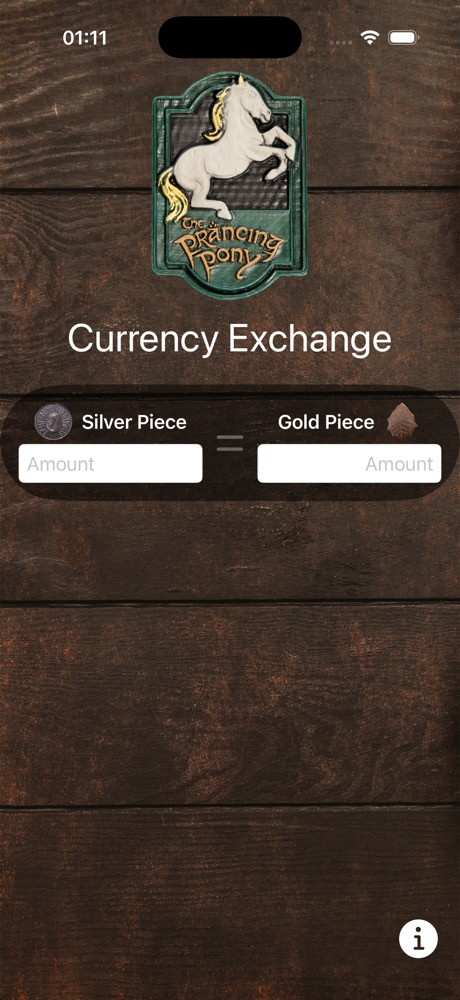
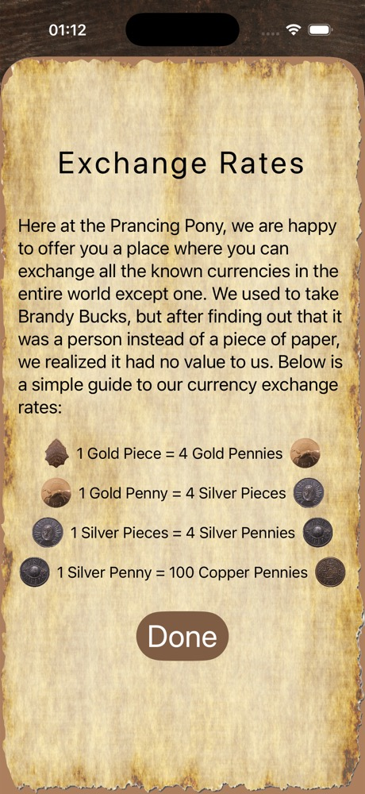
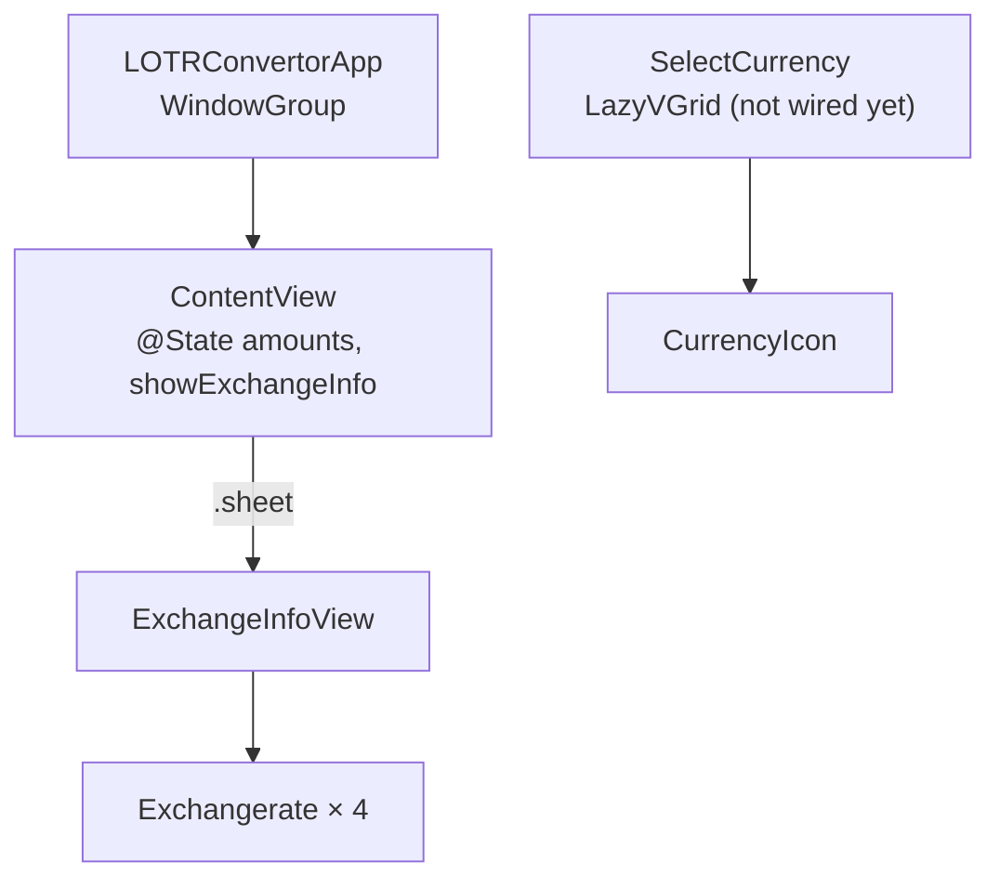

# LOTR Converter

[](https://github.com/eshginfarzali/LOTR_Convertor_APP/actions/workflows/ci.yml)
[](LICENSE)


A SwiftUI app themed on the Prancing Pony inn from *The Lord of the Rings*, for converting between Middle-earth coins. I am building it lesson by lesson to practise SwiftUI layout, state and navigation, so it is **work in progress**: the screens are in place, but the conversion itself is not implemented yet.

<p align="center">
  
  &nbsp;&nbsp;
  
</p>

## What works today

- **Main screen:** a full-bleed background, the Prancing Pony sign, two currency panels (Silver Piece and Gold Piece) with amount fields, and an animated `=` symbol (`symbolEffect(.pulse)`).
- **Exchange rates sheet:** opened with the ⓘ button, it shows the rate table on a parchment background and closes with **Done** (`@Environment(\.dismiss)`).
- **Reusable views:** `Exchangerate` (one rate row with two coin images) and `CurrencyIcon` (a coin tile for the currency picker).
- **Currency picker layout:** `SelectCurrency` lays out coin tiles in a three-column `LazyVGrid`. It is not connected to the main screen yet.

The rates shown in the app:

| From          | To                 |
| ------------- | ------------------ |
| 1 Gold Piece  | 4 Gold Pennies     |
| 1 Gold Penny  | 4 Silver Pieces    |
| 1 Silver Piece | 4 Silver Pennies  |
| 1 Silver Penny | 100 Copper Pennies |

## Architecture

The app is plain SwiftUI with local `@State`. There are no packages or third-party dependencies.



```
LOTRConvertor/
  LOTRConvertorApp.swift   app entry point
  ContentView.swift        main screen
  ExchangeInfoView.swift   rates sheet
  ExchnageRate.swift       Exchangerate row view
  SelectCurrency.swift     currency picker (in progress)
  CurrencyIcon.swift       coin tile
  Assets.xcassets          backgrounds, coin images, app icon
```

## Getting started

Requirements: Xcode 16.4 or newer, with the iOS 18.5+ SDK.

```bash
git clone https://github.com/eshginfarzali/LOTR_Convertor_APP.git
open LOTR_Convertor_APP/LOTRConvertor.xcodeproj
```

Select an iPhone simulator and press **Run**. To build from the command line without signing:

```bash
xcodebuild build -project LOTRConvertor.xcodeproj -scheme LOTRConvertor \
  -destination 'generic/platform=iOS Simulator' CODE_SIGNING_ALLOWED=NO
```

The scheme is shared (`xcshareddata`), so it works on a fresh clone and in CI.

## Testing

There is no test target yet, because the app has no logic to test beyond layout. Unit tests will come with the conversion logic (see the roadmap). CI builds the app for the iOS Simulator on every push and pull request.

## Roadmap

- [ ] Currency model (`enum Currency`) with conversion between any two coins, plus unit tests
- [ ] Two-way binding: typing in either field updates the other
- [ ] Open `SelectCurrency` from the coin buttons and use the selection on the main screen
- [ ] Remember the last selected currencies (`@AppStorage`)
- [ ] Resize the large background textures (about 14 MB of PNG/JPEG) to cut the app size

## License

Code: [MIT](LICENSE) © Eshgin Farzaliyev. *The Lord of the Rings* names belong to their respective owners. This is a non-commercial learning project.
